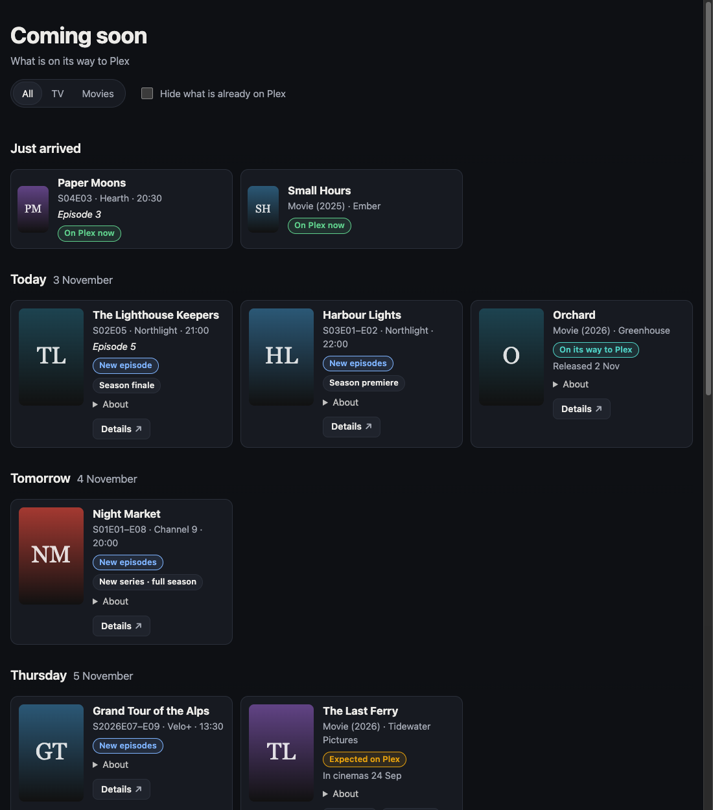

# upcomarr

A read-only "coming soon" page for the people you share Plex with. It shows the upcoming
episodes in Sonarr and the upcoming movies in Radarr, without giving anyone a way into the
arrs.



- **Episodes** are grouped by day in your time zone. A season dropped at once, or a weekend
  of race sessions, collapses into one card ("S02E01–E08").
- **Movies** go on the day they are expected on Plex (the digital release, else the physical
  one), with the cinema date as context. A movie with only a cinema date shows as "In cinemas".
- **Just arrived** lists what landed in the last few days.
- **Highlights** flag premieres and finales: New series, Season premiere, Full season (a whole season on
  one day), Mid-season finale, Season finale and Series finale, from Sonarr's own data.
- **Buttons** on each card: the film's trailer (from Radarr), and a details link to your request app or
  any site you choose (see [Detail links](#detail-links)), and **Add to calendar** on everything still
  coming (see [Calendar buttons](#calendar-buttons)).
- **On a phone** it works as well as on a desktop, and needs no JavaScript. With JavaScript,
  viewers can filter to TV or movies and hide what is already on Plex.

## The security model

Sonarr and Radarr have one kind of API key, and it is an admin key. A dashboard widget that
calls the arr from the page's own server puts that key in an internet-facing app. upcomarr
splits the job in two instead:

| Container | Holds the key? | Network | Job |
| --- | --- | --- | --- |
| `upcomarr` | yes | reaches the arrs; nothing connects to it (metrics are optional) | every 30 minutes, fetches the calendars and renders a static site into a volume |
| `upcomarr-web` | **no** | an `internal` network: no route to your LAN or the internet | serves that volume, read-only, with nginx |

What reaches the volume is controlled in four places:

1. **An allowlist.** Records are projected to a fixed set of fields (title, episode numbers,
   air time, network, overview, release dates, a poster) before anything is rendered. Paths,
   file details, tags, quality profiles and arr ids never leave the generator.
2. **Posters are cached by the generator**, from the arr's own API, and named by a hash of
   their bytes. Viewers' browsers fetch nothing from any other origin. The page's
   Content-Security-Policy is `default-src 'none'` with `'self'` for images, styles and
   scripts, and the page has no inline script or style.
3. **A leak check before every publish.** Each run searches the finished build for the API
   keys, the arr URLs and hosts, every file-system path the arrs returned on that run, and
   markers such as `/api/` and `lastWrite`. Any hit fails the run, and the previous build stays
   up.
4. **The HTTP client refuses redirects** (urllib would otherwise forward the key to any host
   a redirect names). It also ignores `HTTP(S)_PROXY`, and bounds every request in time and
   size.

The tests enforce this end to end. The fixtures fill every field the code should not read with
canaries, and a full run must publish none of them, nor any key, host, path or internal id.

upcomarr has no logins of its own. Put it behind something that does: Cloudflare Access,
Authelia, oauth2-proxy, or your reverse proxy's auth.

## Running it

```yaml
# compose.yaml (the full example, with notes, is in this repository)
services:
  upcomarr:
    image: ghcr.io/realshaunoneill/upcomarr:0.3.0
    environment:
      SONARR_URL: http://sonarr:8989
      SONARR_API_KEY_FILE: /run/secrets/sonarr_api_key
      RADARR_URL: http://radarr:7878
      RADARR_API_KEY_FILE: /run/secrets/radarr_api_key
      TZ: Europe/Dublin
    secrets: [sonarr_api_key, radarr_api_key]
    volumes: [site:/out]
    networks: [arr]
    read_only: true
    tmpfs: [/tmp]
    cap_drop: [ALL]
    security_opt: ["no-new-privileges:true"]

  upcomarr-web:
    image: ghcr.io/realshaunoneill/upcomarr-web:0.3.0
    volumes: [site:/srv/site:ro]
    networks: [upcomarr-web] # put your tunnel or reverse proxy on this network too
    read_only: true
    tmpfs: [/tmp]
    cap_drop: [ALL]
    security_opt: ["no-new-privileges:true"]

volumes:
  site: {}
networks:
  arr: {}
  upcomarr-web:
    internal: true
```

Point your proxy at `http://upcomarr-web:8080`. An `internal` network cannot publish ports.
If you would rather use `ports:`, make that network non-internal. The web container can then
reach your LAN, though it still holds nothing worth taking.

To check the configuration without starting the loop, run
`docker compose run --rm upcomarr probe`. It reaches each arr and prints which settings are
set, never their values.

## Configuration

| Variable | Default | |
| --- | --- | --- |
| `SONARR_URL`, `SONARR_API_KEY` | | Either source can be left out. Every secret also accepts `_FILE`. |
| `RADARR_URL`, `RADARR_API_KEY` | | |
| `TZ` | `UTC` | The time zone for days and air times. |
| `SONARR_DAYS_AHEAD` | `60` | How far ahead to look for episodes. |
| `RADARR_DAYS_AHEAD` | `90` | How far ahead to look for movies. |
| `DAYS_BEHIND` | `3` | How long items stay in "Just arrived". |
| `SONARR_TAGS`, `RADARR_TAGS` | | Comma-separated tag labels; only items with one of them are shown. An unknown label fails the source rather than showing everything. |
| `INCLUDE_UNMONITORED` | `false` | |
| `SITE_TITLE` | `Coming soon` | |
| `INTERVAL_SECONDS` | `1800` | It also refreshes just after local midnight, so "Today" is right. |
| `METRICS_PORT` | `0` (off) | Prometheus metrics on `/metrics`. |
| `REQUEST_TIMEOUT_SECONDS` | `20` | A total limit per request. |
| `SEERR_URL` | | Your request app's address as viewers see it, e.g. `https://request.example.com`. Adds a details button that opens each title in Seerr, Overseerr or Jellyseerr. |
| `DETAILS_URL_MOVIE`, `DETAILS_URL_TV` | | Templates for the details button, used instead of (or alongside) `SEERR_URL`. |
| `DETAILS_LABEL` | `Details` | The details button's text. |
| `SHOW_TRAILERS` | `true` | A Trailer button on films, linking to YouTube. |
| `CALENDAR_BUTTONS` | `true` | An Add to calendar button on each card still coming. |

If an arr is unreachable, the page keeps that source's last good data and says how old it is.

### Detail links

`SEERR_URL` is the shortcut: Seerr, Overseerr and Jellyseerr all open a title at `/movie/<tmdb id>` and
`/tv/<tmdb id>`. To point the button anywhere else, set a template with any of `{tmdb}`, `{tvdb}` and `{imdb}`:

```yaml
# The Movie Database
DETAILS_URL_MOVIE: https://www.themoviedb.org/movie/{tmdb}
DETAILS_URL_TV: https://www.themoviedb.org/tv/{tmdb}
DETAILS_LABEL: TMDB
```

```yaml
# IMDb, for films and series alike
DETAILS_URL_MOVIE: https://www.imdb.com/title/{imdb}/
DETAILS_URL_TV: https://www.imdb.com/title/{imdb}/
DETAILS_LABEL: IMDb
```

A template must be an `http(s)` URL with its placeholders after the host. The ids are checked before they
are used: positive numbers for TMDB and TVDB, `tt` plus digits for IMDb, and YouTube's id format for
trailers. A title whose id is missing gets no button rather than a broken one. All links open in a new tab
with no referrer, and the page still loads nothing from any other site.

### Calendar buttons

Each card that is still coming (an episode not yet on Plex, a film expected on Plex or in cinemas) gets an
**Add to calendar** button. It is a one-off `.ics` file, generated with the page:

- **Episodes** are timed events at their air time, lasting the runtime (an hour if Sonarr does not know it).
  A season dropped at once is one event. With no air time, they are all-day events.
- **Films** are all-day events on the day they are expected on Plex, or their cinema date.
- **Events are marked free**, so they never block anyone's diary.
- **Each event's id comes from the title and episode label, not the date.** Adding a card again after its date
  moves updates the event in calendars that honour ids, rather than adding a second one.

**It works behind any login.** The file is served from the same origin as the page, so it is downloaded with the
viewer's existing session (Cloudflare Access, Authelia, anything), and the calendar app only imports it. It does
not fetch the file again. The trade-off is that an imported event does not follow later date changes.

A *subscribed* calendar would keep up, but calendar apps fetch subscriptions themselves, without the viewer's
login, so it would need an unauthenticated (if unguessable) URL. upcomarr does not offer one yet.

## Monitoring

- **`/_status.json`** on the web container: `ok`, plus per-source `ok`, `stale` and
  `last_success`, with short error codes (never error text).
- **Metrics** (`METRICS_PORT`):
  - `upcomarr_source_up{source}`
  - `upcomarr_source_last_success_timestamp_seconds{source}`
  - `upcomarr_entries{kind}`
  - `upcomarr_last_run_success`
  - `upcomarr_last_publish_success` and `upcomarr_last_publish_timestamp_seconds`: alert on the second, because a
    publish refused by the leak check still fetches every source fine
  - `upcomarr_run_duration_seconds`
- **Health:** both images have a Docker `HEALTHCHECK`.

## Development

Python 3.13, standard library only.

```sh
PYTHONPATH=src python -m unittest discover -s tests -t .
OUT_DIR=.demo PYTHONPATH=src python -m upcomarr demo   # a sample site in .demo/current
tests/smoke.sh <generator image> <web image>          # the container test CI runs
```

## Licence

MIT
